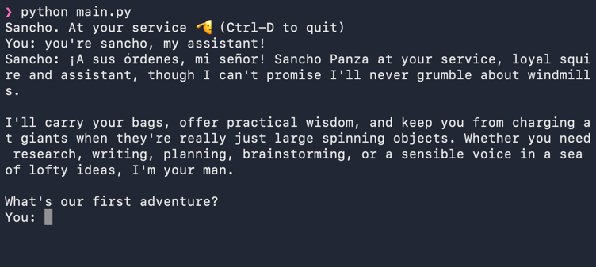
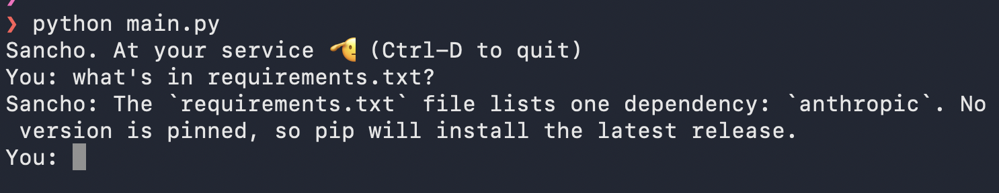
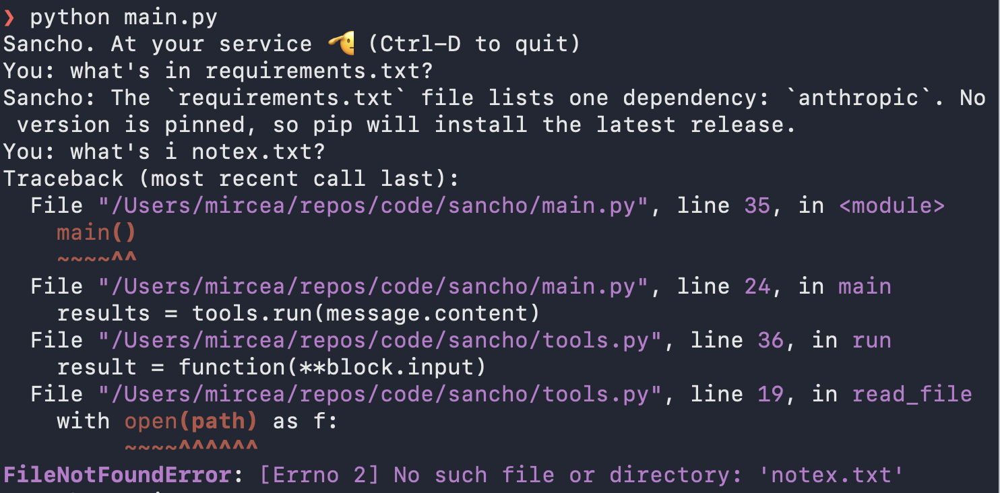
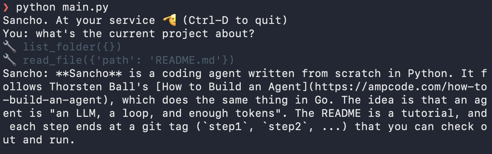
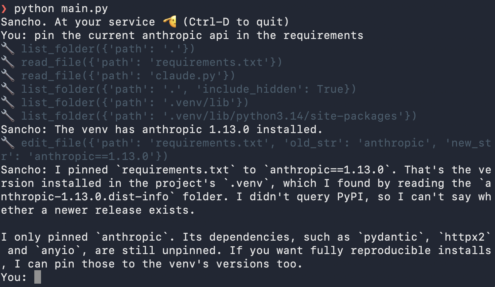

# Sancho

<p align="center">
  
  <br>
  <sub>Image: <a href="https://easy-peasy.ai/ai-image-generator/images/don-quijote-sancho-panza-la-mancha-spain">Easy-Peasy.AI</a>,
  <a href="https://creativecommons.org/licenses/by/4.0/">CC BY 4.0</a>; everything but Sancho grayed out.</sub>
</p>

A coding agent in less than 200 lines of Python, built from scratch one small step at a time.

# Inspiration
Sancho follows Thorsten Ball's [How to Build an Agent](https://ampcode.com/how-to-build-an-agent), which builds the same
thing in Go. His point: an agent is not magic, it's "an LLM, a loop, and enough tokens". Python lets us show that with
even less ceremony.
 

# Implementation
Each step below ends at a git tag (`step1`, `step2`, ...), so you can check out any step and run it:

```bash
git checkout step1
```

| Step | Tag | What Sancho can do | What's new in the code |
|---|---|---|---|
| [1. A chatbot](#step-1-a-chatbot) | `step1` | talk | the chat loop; the conversation is its memory |
| [2. A fool, but with a tool](#step-2-a-fool-but-with-a-tool) | `step2` | read a file | tool definitions, and the inner loop that makes it an agent |
| [3. When tools fail](#step-3-when-tools-fail) | `step3` | survive a missing file | errors go back to Claude with `is_error` |
| [4. Looking around](#step-4-looking-around) | `step4` | find files itself | a second tool; the loop doesn't change |
| [5. A coding agent](#step-5-a-coding-agent) | `step5` | change files | `edit_file`: search and replace, one match only |

## Setup

Sancho works with the Anthropic API. You need an Anthropic API key to run this example. 

```bash
python3 -m venv .venv && source .venv/bin/activate
pip install -r requirements.txt
export ANTHROPIC_API_KEY=...
python main.py
```

## Prerequisite: A few facts about the Anthropic API

Sancho talks to Claude through the Messages API. The whole agent rests on four facts about it:

1. **It is stateless.** Claude remembers nothing between calls. Every request carries the whole conversation so far, so keeping the conversation is the client's job.
2. **Roles alternate.** The conversation is a list of messages with `"role": "user"` and `"role": "assistant"`, taking turns, starting with the user.
3. **A reply is a** list of content blocks**, not a string.** In step 1 we only care about `text` blocks. Later, tool calls
   arrive as blocks too.
4. **`stop_reason` says what happens next.** `"end_turn"` means Claude is done and it's our turn. Later, `"tool_use"`
   will mean Claude wants us to run something.

In Python the messages are plain dicts, exactly the JSON that goes over the wire, so what you read in the code is what the API sees.

## Step 0: Talking to Claude: a thin wrapper

All calls to Claude go through one small file, `claude.py`. It's the only file that imports `anthropic`.

It exists because I don't like one of the SDK's names. To get Claude's next answer, the SDK has you call
`client.messages.create(...)`, which reads as "create a message". So we wrap it in a function whose name says what we
actually want:

```python

import anthropic

client = anthropic.Anthropic()  # reads ANTHROPIC_API_KEY from the environment


def get_next_answer(conversation):
    """Send the whole conversation to Claude and return its reply."""
    return client.messages.create(model=MODEL, max_tokens=16000, messages=conversation)
```

Underneath it's one HTTP POST to `/v1/messages`, which blocks until the reply is complete. `max_tokens` caps the length
of the reply. The wrapper only renames: it takes the conversation in the API's format and returns the API's reply object
unchanged.

In `main.py` we `import claude`, so every call reads `claude.get_next_answer(...)` and you can see exactly where the
code talks to Claude.

## Step 1: a chatbot

> [!TIP]
> Code for this step: `git checkout step1`

The smallest useful thing: read a line, send it to Claude, print the answer, repeat.

```python
def main():
    conversation = []
    print("Sancho. At your service 🫡 (Ctrl-D to quit)")

    while True:
        try:
            user_input = input("You: ")
        except (EOFError, KeyboardInterrupt):
            break
        if not user_input.strip():
            continue

        conversation.append({"role": "user", "content": user_input})
        message = claude.get_next_answer(conversation)
        conversation.append({"role": "assistant", "content": message.content})

        for block in message.content:
            if block.type == "text":
                print("Sancho:", block.text)
```

Things to notice:

- **`conversation` is Sancho's whole memory.** Because the API is stateless, we send the full list every turn and append
  Claude's reply to it.
- **We print only the `text` blocks.** The model may also return a `thinking` block (its reasoning, empty by default),
  so we don't assume the first block is the answer.
- **Empty lines are skipped** because the API rejects a message with empty text.

This is a chatbot, not yet an agent. It can talk, but it can't do anything. That's step 2.



## Step 2: A fool, but with a tool

> [!TIP]
> Code for this step: `git checkout step2`

An agent is a chatbot that can do things. Sancho's first ability: reading a file.

Claude can't touch your disk, but it can ask. We tell it which tools exist; when it wants one, it stops and replies with
a request instead of an answer; we run the tool and send back the result. Claude never runs anything itself. Sancho
does.

### Defining a tool

A tool is three things: a name, a description written for Claude, and a JSON Schema for its input.

```python
READ_FILE = {
    "name": "read_file",
    "description": "Read a file and return its contents as text. ...",
    "input_schema": {...},  # one string: "path"
}
```

The full definition is in `tools.py`, next to the function that does the work:

```python
def read_file(path):
    with open(path) as f:
        return f.read()
```

Things to notice:

- **The description is a prompt.** Claude decides when and how to call the tool from the description alone, so it says
  what the tool does and when to use it.
- **The definition is just data.** Nothing ties `READ_FILE` to `read_file`. Connecting the name Claude asks for to the
  function we run is our job.

### The round trip

1. **We send the tools** with every request, next to the conversation. `get_next_answer` gets a second argument,
   `tools`, and passes it on as `tools=tools`.
2. **Claude asks.** The reply's `stop_reason` is `"tool_use"`, and its content holds a `tool_use` block with an `id`,
   the tool's `name`, and its `input`.
3. **We run the tool and answer** with a user message holding a `tool_result` block. Its `tool_use_id` tells Claude
   which request this result belongs to.
4. **We call Claude again**, without waiting for the user, until `stop_reason` is `"end_turn"`.

### Running the tools

`tools.py` keeps two lookups: `DEFINITIONS`, the list we send to Claude, and `FUNCTIONS`, which maps each tool's name to
the Python function that does the work. `run` takes the tool calls from Claude's reply and turns each one into a
`tool_result`:

```python
def run(tool_calls):
    results = []

    for call in tool_calls:
        function = FUNCTIONS[call.name]
        print(f"\033[90m🔧 {call.name}({call.input})\033[0m")
        result = function(**call.input)
        results.append(
            {
                "type": "tool_result",
                "tool_use_id": call.id,
                "content": result,
            }
        )

    return results
```

Things to notice:

- **`**call.input` unpacks the arguments.** `call.input` is a dict like `{"path": "requirements.txt"}`, and `**` turns
  it into `path="requirements.txt"`. So `run` works for any tool, whatever its arguments are called.
- **The gray 🔧 line** shows every tool call as it happens, so you can watch the agent act.

### The agent loop

The user's turn now hands over to `agent_loop`: keep asking Claude until it stops asking for tools.

```python
def agent_loop(conversation):
    """Keep asking Claude, and running the tools it asks for, until it's done."""
    while True:
        message = claude.get_next_answer(conversation, tools.DEFINITIONS)

        # Every reply goes into the conversation, tool calls included: the API
        # matches each tool_result to a tool_use in the previous assistant message,
        # and wants the reply's thinking blocks sent back unchanged.
        conversation.append({"role": "assistant", "content": message.content})

        text = claude.text_of(message)
        if text:
            print("Sancho:", text)

        if message.stop_reason != "tool_use":
            return

        tool_calls = claude.tool_calls_of(message)
        results = tools.run(tool_calls)
        conversation.append({"role": "user", "content": results})


def main():
    conversation = []
    print("Sancho. At your service 🫡 (Ctrl-D to quit)")

    try:
        while True:
            user_input = input("You: ")
            if not user_input.strip():
                continue

            conversation.append({"role": "user", "content": user_input})
            agent_loop(conversation)
    except (EOFError, KeyboardInterrupt):
        pass
```

Things to notice:

- **Two loops, two turns.** The loop in `main` is your turn: it waits for input. `agent_loop` is the agent working:
  one question from you can take several rounds with Claude, and you type nothing in between. `agent_loop` is the whole
  difference between the chatbot of step 1 and an agent.
- **There is one place that asks Claude.** Ask, record, show, stop if Claude is done; otherwise run the tools, answer,
  and ask again.
- **All results go back in one user message.** Claude can ask for several tools in one reply; the answers travel
  together.
- **A reply has two parts we care about:** the text to show, and the tool calls to run. `claude.text_of` and
  `claude.tool_calls_of` pick them out of the reply's blocks (a reply can also hold `thinking` blocks, which stay in the
  conversation untouched). Knowing the block format is `claude.py`'s job; deciding what to do with the parts is
  `main.py`'s.
- **We print the text of every reply**, not just the last one, so a "Let me look at that file" before a tool call isn't
  lost.
- **The `try` wraps the whole loop**, not just `input()`. So Ctrl-C also works while the agent is busy, and ends Sancho
  cleanly instead of with a traceback.

Ask about a file and watch Sancho read it:



Now ask about a file that doesn't exist:



`open()` raises `FileNotFoundError`, nothing catches it, and Sancho dies. Fixing that is step 3.

## Step 3: when tools fail

> [!TIP]
> Code for this step: `git checkout step3`

A tool that fails shouldn't take Sancho down. The error is information: if Claude learns that `notex.txt` doesn't
exist, it can say so, or try another path. So instead of crashing, we send the error back as the tool's result:

```python
def run(tool_calls):
    results = []

    for call in tool_calls:
        try:
            print(f"\033[90m🔧 {call.name}({call.input})\033[0m")
            function = FUNCTIONS[call.name]
            result = function(**call.input)
            results.append(
                {
                    "type": "tool_result",
                    "tool_use_id": call.id,
                    "content": result,
                }
            )
        except Exception as e:
            results.append(
                {
                    "type": "tool_result",
                    "tool_use_id": call.id,
                    "content": str(e),
                    "is_error": True,
                }
            )

    return results
```

Things to notice:

- **`"is_error": True`** tells Claude the tool failed, so it reads `str(e)` as an error message and not as the file's
  contents.
- **The lookup is inside the `try` too.** If Claude asks for a tool that doesn't exist, `FUNCTIONS[block.name]` raises
  `KeyError`, and that becomes an error result as well.
- **Every `tool_use` still gets exactly one `tool_result`.** The API requires an answer for each request, and failing
  is an answer.

Ask about `notex.txt` again, and Sancho tells you, in its own words, that the file isn't there.

## Step 4: looking around

> [!TIP]
> Code for this step: `git checkout step4`

So far you have to name the file. With a second tool, `list_folder`, Sancho can look around first and find what it needs
itself.

```python
def list_folder(path=".", include_hidden=False):
    names = sorted(os.listdir(path))
    if not include_hidden:
        names = [name for name in names if not name.startswith(".")]
    if not names:
        return "(empty folder)"
    return "\n".join(
        name + "/" if os.path.isdir(os.path.join(path, name)) else name for name in names
    )
```

We made some choices here:

- **Not recursive.** On a big project a recursive listing would hand Claude thousands of names on every call. One
  folder at a time is cheap, and Claude calls the tool again for a subfolder when it wants to look deeper.
- **Folders end with `/`**, so Claude knows what it can look into.
- **Hidden entries are skipped** unless Claude asks: `.git` and `.venv` are noise almost always, but sometimes it needs
  a `.gitignore`.
- **Sorted, and never empty.** Sorting keeps the output stable; an empty folder says so instead of returning `""`.

The definition introduces two things: parameters that are optional (there is no `required` list), and a boolean.

```python
LIST_FOLDER = {
    "name": "list_folder",
    "description": "List what's in a folder, one name per line. Folders end with a slash. "
    "Not recursive: to see inside a subfolder, call it again with that subfolder. "
    "Hidden entries (starting with a dot, e.g. .gitignore) are left out unless you ask for them.",
    "input_schema": {
        "type": "object",
        "properties": {
            "path": {
                "type": "string",
                "description": "Folder to list, relative to the current folder. Defaults to the current folder.",
            },
            "include_hidden": {
                "type": "boolean",
                "description": "Also list hidden entries. Defaults to false.",
            },
        },
    },
}
```

The description does real work again: it tells Claude that the tool isn't recursive and how to ask for hidden
entries.

And then we register it:

```python
DEFINITIONS = [READ_FILE, LIST_FOLDER]
FUNCTIONS = {READ_FILE["name"]: read_file, LIST_FOLDER["name"]: list_folder}
```

That's all. **`run` and the agent loop don't change.** Adding a tool means writing a function, describing it, and adding
it to the two lookups; `**call.input` takes care of the arguments, whatever they are.

Ask about the project without naming a file:



Claude called `list_folder({})`: no arguments, so the defaults apply. It saw `README.md` in the listing, read it, and
answered. You can watch the agent decide what to look at.

## Step 5: a coding agent

> [!TIP]
> Code for this step: `git checkout step5`

Sancho can look around and read. The last tool lets it write: `edit_file` replaces one piece of text in a file with
another.

```python
def edit_file(path, old_str, new_str):
    if old_str == new_str:
        raise ValueError("old_str and new_str are the same")

    if old_str == "":
        if os.path.exists(path):
            raise ValueError(f"{path} already exists; to change it, give the text to replace")
        folder = os.path.dirname(path)
        if folder:
            os.makedirs(folder, exist_ok=True)
        with open(path, "w") as f:
            f.write(new_str)
        return f"Created {path}"

    with open(path) as f:
        content = f.read()

    count = content.count(old_str)
    if count == 0:
        raise ValueError(f"old_str not found in {path}")
    if count > 1:
        raise ValueError(f"old_str appears {count} times in {path}; include more context to make it unique")

    with open(path, "w") as f:
        f.write(content.replace(old_str, new_str))
    return f"Edited {path}"
```

Things to notice:

- **Search and replace, not rewrite.** Claude sends only the text it changes, not the whole file. That's cheaper, and
  safer: anything Claude doesn't mention stays exactly as it was, so it can't drop half a file by accident.
- **`old_str` must appear exactly once.** If it appears twice, we don't guess which one Claude meant; we ask it for
  more context. To know `old_str`, Claude has to have read the file, so `read_file` then `edit_file` becomes the
  natural pattern.
- **Every failure is a `raise`.** Step 3 turns exceptions into `is_error` results, so Claude reads "appears 2 times;
  include more context" and tries again.
- **The same tool creates files:** an empty `old_str` and a file that doesn't exist yet. It refuses to create over an
  existing file, so a create can't silently overwrite.

The description teaches Claude these rules:

```python
EDIT_FILE = {
    "name": "edit_file",
    "description": "Edit a file by replacing old_str with new_str. "
    "old_str must appear exactly once in the file, so include enough surrounding lines to make it unique. "
    "Read the file first, so old_str matches it exactly, including whitespace. "
    "To create a new file, pass an empty old_str and the whole content as new_str.",
    "input_schema": {
        "type": "object",
        "properties": {
            "path": {
                "type": "string",
                "description": "Path to the file, relative to the current folder.",
            },
            "old_str": {
                "type": "string",
                "description": "The exact text to replace. Empty to create a new file.",
            },
            "new_str": {
                "type": "string",
                "description": "The text to put in its place.",
            },
        },
        "required": ["path", "old_str", "new_str"],
    },
}
```

Ask Sancho to change something in its own repo:



It listed the folder, read `requirements.txt`, went looking in `.venv` for the installed version, and then made a
one-line edit.

That's the whole agent: an LLM, a loop, and three tools.

## Exercises

- **See it think.** Sonnet 5.5 thinks before many replies, but the API returns the thinking blocks with empty text.
  Pass `thinking={"type": "adaptive", "display": "summarized"}` to `messages.create` to get a readable summary, then
  write a `claude.thinking_of(message)` next to `text_of` (the block type is `"thinking"`, its text is in
  `block.thinking`) and print it in gray. Not every reply thinks: ask something that needs a decision.
- **Ask before writing.** `edit_file` changes files without asking. Make Sancho show the edit and ask
  `Apply? [y/N]` first, and when you answer no, send Claude an error result saying the user declined. Where does that
  question belong: in `tools.py`, or in `main.py`?
- **Forget old tool results.** Every turn resends the whole conversation, including every file Sancho ever read. Ask
  about a few files, then watch `message.usage.input_tokens` grow. Make Sancho forget old tool results. Before you
  write code: can you simply delete an old `tool_result` from the conversation? What does the API say about a
  `tool_use` that has no answer? And what is the API's own way of doing this (look for "context editing")?
- **No tool API.** Sancho leans on the API's tool support: tool definitions, `tool_use` and `tool_result` blocks,
  `stop_reason`. How would it work with only the plain chat API, user and assistant taking turns with text? What
  would the system prompt have to say about the tools, and about the format of Claude's answer? How does the loop
  find the tool call in a reply, and what does it send back when the reply has none, or two? How does it know Claude
  is done? (mini-swe-agent works this way: compare its `config/default.yaml`.)

## Lessons learned

Things that weren't obvious while building Sancho.

**About the API**

- **The API forgets everything.** The conversation lives in the client and is resent in full on every call. The agent
  loop exists because of that.
- **A reply is a list of blocks, and the first one may not be the text.** Sonnet 5.5 thinks by default, so a reply can
  start with an (empty) `thinking` block: `message.content[0].text` prints nothing. Look for `text` blocks instead.
- **Always record Claude's whole reply, tool calls included.** Each `tool_result` must answer a `tool_use` in the
  assistant message right before it, and thinking blocks must go back unchanged. Appending `message.content` as it is
  takes care of both. All results of one reply go back together, in one user message.

**About tools**

- **The description is a prompt.** We never told Claude to look at hidden files; it passed `include_hidden: true` on
  its own because the description said hidden entries are left out "unless you ask for them".
- **A failing tool should answer, not crash.** Send the exception back with `is_error: true` and Claude adapts. The
  lookup of the tool by name belongs inside the `try` too: Claude may ask for a tool that doesn't exist.
- **Cheap tools beat thorough ones.** A recursive listing hands Claude all of `.git` and `.venv`; one folder at a time
  lets it explore only what it needs.
- **Edit by search and replace, with exactly one match.** Claude sends only what changes, can't drop the rest of a file
  by accident, and is asked for more context instead of us guessing which match it meant.

**About the code**

- **Turn the loop around.** "Ask once, then loop while Claude wants tools" duplicates the ask-record-show lines. "Keep
  asking until Claude doesn't want a tool" has one place that talks to Claude.
- **Print every reply, and exit only after printing.** Printing only the last reply loses "Let me look at that file";
  breaking before printing loses the answer itself.
- **Keep the provider's format in one place.** `claude.py` knows what blocks look like (`text_of`, `tool_calls_of`);
  `main.py` decides what to do with them. Printing is the interface, so it stays out of the wrapper.
- **A thin wrapper beats a model of our own.** Wrapping replies in our own classes leaks at once: the thinking blocks
  must go back to the API untouched. Renaming `messages.create` to `get_next_answer` was the part worth having.
